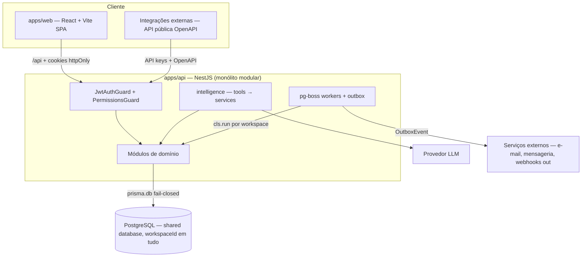
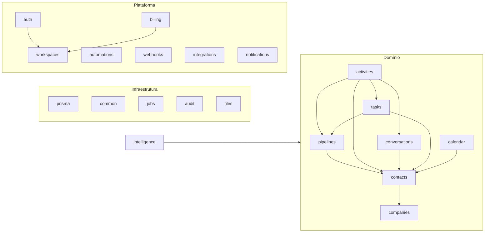

# ARCHITECTURE — Veyra

## 1. Estilo arquitetural

**Monólito modular** (ADR-001): uma API NestJS com módulos de domínio bem delimitados, um SPA React, um Postgres. Sem microsserviços, sem event bus distribuído, sem camadas genéricas (Repository, "core utils") sem necessidade demonstrada em ADR. A modularidade vem de boundaries de import explícitos entre módulos — não de processos separados.

## 2. Visão de contêineres



## 3. Camadas dentro da API

```
Request
  → JwtAuthGuard (global; valida JWT, revalida tokenVersion da membership,
                  seta workspaceId/userId/membershipId no CLS)
  → PermissionsGuard (global, default-deny: endpoint privado sem @RequirePermissions()
                      é negado; @AuthenticatedOnly() é a exceção rara e revisável)
  → ZodPipe (valida body/query contra schema de packages/contracts)
  → Controller (rota + validação; zero lógica de negócio)
  → Service (regra de negócio, auditoria, outbox)
  → PrismaService.db (client extension: filtro automático por workspaceId, fail-closed)
  → PostgreSQL
```

Regras:

- Controllers finos; toda regra vive em services.
- **Sem camada Repository** (ADR-005): se um service cresce demais, divida em dois services.
- **Relógio de agendamento** (ADR-049): um instante que o banco compara com `now()` (claim, lease, varredura) é escrito pelo banco: DEFAULT, trigger ou `now()` em SQL. Nunca pelo `new Date()` do Node nem pelo `@default(now())` e `@updatedAt` do Prisma, que usam o relógio do Node. A sessão do banco fica em UTC.
- Endpoints são privados por padrão (guard global); exceção via `@Public()` explícito. Autorização é **default-deny**: sem `@RequirePermissions(...)`, o endpoint privado é negado; `@AuthenticatedOnly()` cobre o caso raro de rota que só exige autenticação (ADR-016).

## 4. Multi-tenancy (resumo — detalhe em SECURITY.md)

- Toda entidade de domínio tem `workspaceId` e entra no set `WORKSPACE_MODELS`.
- `PrismaService` expõe `db` (extension que injeta `workspaceId` em creates, `AND: [{workspaceId}, where]` em queries, bloqueia `findUnique`/`update`/`delete`/`upsert` e **lança erro** sem workspace no CLS) e `raw` (sem filtro, uso excepcional documentado).
- Violações de unique (P2002), de FK (P2003) e de exclusão (`23P01`, que o Prisma com driver adapter entrega como P2039 genérico, com o código original em `meta.driverAdapterError.cause`) viram **409, nunca 500**, pelo filtro global (`PrismaExceptionFilter`). O `detail` do Postgres, que traz ids e valores, não vai para a resposta nem para o log. A violação de `CHECK` (`23514`) continua 500 **de propósito**: o contrato valida as mesmas faixas, então ela só aconteceria por defeito.
- `raw` restrito a: identidade global (User/RefreshToken), autenticação, provisionamento controlado, jobs cross-workspace, rotinas administrativas justificadas.
- FKs compostas garantem integridade cross-workspace no banco (`FOREIGN KEY (workspaceId, xId) REFERENCES X(workspaceId, id)`).
- Defesa em profundidade futura: RLS no Postgres (ADR adiado com gatilho).

## 5. Módulos do Core e grafo de dependências

Módulos previstos em `apps/api/src/`:

`auth`, `workspaces` (workspace, membership, role, team, invite), `contacts`, `companies`, `custom-fields`, `pipelines` (pipeline, stage, deal), `tasks`, `notes`, `activities` (timeline), `conversations` (conversation, message, channel), `calendar`, `notifications`, `files`, `automations`, `webhooks`, `integrations`, `audit`, `billing`, `intelligence`, `jobs`, `prisma`, `common`.

Regras de dependência:



- Módulos de domínio **não se importam lateralmente de forma ad-hoc**; aresta nova estrutural exige ADR.
- `integrations`/`webhooks` são infraestrutura de borda: nunca dependem de módulos de domínio específicos além dos contratos que expõem.
- `intelligence` depende de services de domínio (via tools) — nunca do Prisma.
- Nenhum módulo do Core importa nada de um vertical.

## 6. Estratégia de verticais

Um vertical é um conjunto de módulos NestJS, contratos e telas que estende o Core sem que o Core o conheça (ADR-015). O contrato de extensão está no **ADR-047**; o primeiro vertical, Veyra Clinics para estética, no **ADR-048**.

**Onde mora.** `apps/api/src/verticals/<v>/`, `packages/contracts/src/verticals/<v>/` e `apps/web/src/verticals/<v>/`. O schema fica em arquivo próprio, no **mesmo banco** e na mesma pasta de migrations (schema Prisma em vários arquivos), porque as FKs compostas para entidades do Core exigem o mesmo banco.

**Barreira.** Só a raiz de composição importa `verticals/`: `src/composition.ts` e `app.module.ts` na API, e `src/composition.ts(x)` no web. As extensões entram no Core por `ExtensionsModule.forRoot(COMPOSITION)` (`src/extensions/`). O restante do Core é proibido de importar o vertical por lint e por teste de fronteira, como no ADR-027. Quando o Core precisa de uma resposta do vertical, ele declara uma **porta** com nome neutro, e o vertical a implementa.

**Mecanismos de extensão**, em ordem de preferência:

1. **Custom fields** do Core, para atributo simples sem estrutura e **sem dado sensível**: custom fields herdam as permissões do contato.
2. **Extension table 1:1** sobre entidade do Core, com `@@unique([workspaceId, <x>Id])` e FK composta. Exemplo: `ClinicsPatient(workspaceId, contactId)`. Ler "paciente" é o join da extensão com o contato, via service do vertical.
3. **Entidade própria** do vertical, com as mesmas convenções do Core. Exemplos: `ClinicsUnit`, `ClinicsService`, `ClinicsAppointment`. Quando a entidade tem invariante que o banco precisa garantir (por exemplo, agenda sem sobreposição), ela é dona do próprio dado e **não especializa uma entidade genérica do Core**: o agendamento do Clinics não depende de `CalendarEvent` (ADR-048 §2).

**Os seis pontos de composição (ADR-047)**, e somente eles:

| #   | Ponto                                          | Resumo                                                                                                                                                                                                                                                                                      |
| --- | ---------------------------------------------- | ------------------------------------------------------------------------------------------------------------------------------------------------------------------------------------------------------------------------------------------------------------------------------------------- |
| E1  | Modelos protegidos                             | Conjunto composto na raiz (Core ∪ vertical) injetado no `PrismaService`; o teste de drift lê todos os arquivos do schema                                                                                                                                                                    |
| E2  | Permissões e disponibilidade                   | Catálogo próprio com prefixo do vertical; porta de disponibilidade por workspace; checagem de chaves no boot; `SYSTEM_ROLE_TEMPLATES` intocado                                                                                                                                              |
| E3  | Ativação e papéis do vertical                  | CLI do vertical, idempotente; papéis próprios por `systemKey` com prefixo; desativar revoga acesso e não apaga dados                                                                                                                                                                        |
| E4  | Allowlist de auditoria                         | Allowlists compostas; entidade sem allowlist continua como `"[changed]"`                                                                                                                                                                                                                    |
| E5  | Navegação e rotas no web                       | A raiz `composition.tsx` entrega ao Core um hook de grupos e as rotas; `useNavGroups()` (`lib/nav.ts`) compõe o mapa para lateral, rastro e busca. Visível só com o status do vertical confirmado como ativo e com a permissão; carregando ou com erro, oculto e sem consultas              |
| E6  | Restrição de conteúdo por contato e consumidor | Porta neutra consultada por IA (todo envio ao provedor, leitura de persistidos, aprovação, despacho) e por webhooks (na entrega); falha fechada; derivada da **presença** do vertical, não do status de ativação; quem muda a restrição de um contato trava a linha dele (ADR-047 adendo 5) |

**O que não é ponto de extensão** (cada um exige ADR próprio): timeline do Core, catálogo de automações e de eventos de webhook, ferramentas de IA sobre dados do vertical, restrição de leitura por contato nas telas do Core, edição de papéis, quotas e billing por vertical.

**Parametrizar o Core** continua valendo quando o efeito é universal. Exemplos: retorno como `Task` do Core, com título neutro; envio de mensagem pelo serviço de conversas, com aprovação humana. Vale só onde a fronteira de dados do vertical permite: o Clinics, por exemplo, não usa a IA do Core sobre seus contatos (ADR-048 §6).

Direção de dependência: vertical → Core. Nunca o contrário. A skill `create-vertical` operacionaliza este checklist.

## 7. Contratos

- **Internos** (`packages/contracts`): schemas Zod para entrada (`createContactSchema` → `CreateContactInput`) e interfaces TS para saída (`ContactDto`). Backend valida com `ZodPipe`; frontend importa tipos. Fonte única, checada em compile-time nos dois lados.
- **API pública**: OpenAPI gerado a partir dos controllers/schemas (ADR-006), versionada (`/api/v1`), autenticada por API key por workspace com escopos = permissões RBAC.
- Ordem de implementação: `packages/contracts` → `apps/api` → `apps/web`.

## 8. Jobs, outbox e efeitos externos

- **pg-boss** no mesmo Postgres (ADR-007). Kill switch `DISABLE_JOBS`.
- Jobs cross-workspace usam o padrão `runForAllWorkspaces`: itera workspaces via `raw` (justificado) e abre `cls.run()` com o `workspaceId` de cada um, try/catch por workspace — falha de um não derruba os outros.
- **Outbox transacional**: efeito externo (webhook out, e-mail, mensagem) nunca é disparado na transação de domínio. A transação grava `OutboxEvent`; um worker pg-boss entrega com retry/backoff exponencial e idempotência (`dedupeKey` + unique tenant-scoped, capturando P2002).
- **Idempotência HTTP**: endpoints de mutação da API pública aceitam `Idempotency-Key` (armazenada por workspace com TTL).

## 9. Observabilidade

- Logging estruturado (pino) com `requestId` correlacionado, `workspaceId`/`userId` do CLS; **nunca** logar payloads sensíveis ou segredos.
- Filtro global de exceções captura só 5xx (4xx é contrato) e enriquece com rota registrada (sem query string).
- Error tracking (Sentry-compatível) inerte sem DSN, com `sendDefaultPii: false`.
- Healthcheck público `GET /api/health`.
- Métricas e tracing: adiados com gatilho (ADR) — primeiro logs bons.

## 10. Frontend

- SPA React + Vite; estado de servidor em TanStack Query, estado de UI em store leve — nunca duplicar estado de servidor.
- Tabelas densas com TanStack Table; formulários com React Hook Form + resolvers Zod dos contratos.
- `lib/api.ts` é o único lugar com fetch; auth por cookies httpOnly (refresh automático em 401 com deduplicação de refresh concorrente).
- Componentes: primitivos acessíveis Radix/shadcn à la carte em `components/ui/`; componentes de domínio por pasta. Direção visual em `docs/DESIGN_DIRECTION.md`.

## 11. Padrões utilizados (e onde)

| Padrão                       | Onde                           | Por quê                                          |
| ---------------------------- | ------------------------------ | ------------------------------------------------ |
| Client extension fail-closed | `prisma.service.ts`            | Isolamento na camada de dados, não na disciplina |
| Guard global + opt-out       | `JwtAuthGuard` + `@Public()`   | Seguro por default                               |
| Outbox                       | mutações com efeito externo    | Atomicidade domínio+efeito                       |
| Dedupe key                   | notificações, outbox, webhooks | Idempotência barata via unique                   |
| Extension table 1:1          | verticais                      | Estender sem tocar o Core                        |
| CLS (AsyncLocalStorage)      | request e jobs                 | Contexto de tenant sem passar parâmetro          |
| ADR numerado                 | `docs/DECISIONS.md`            | Decisão rastreável no código                     |
