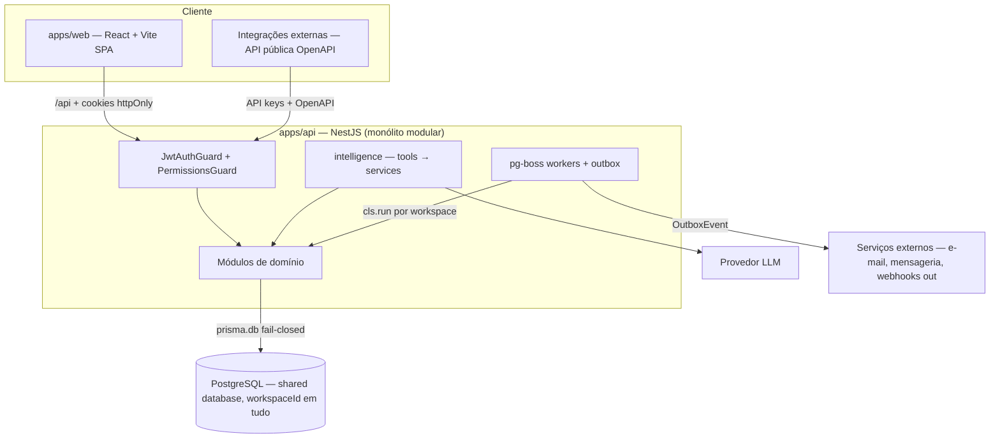
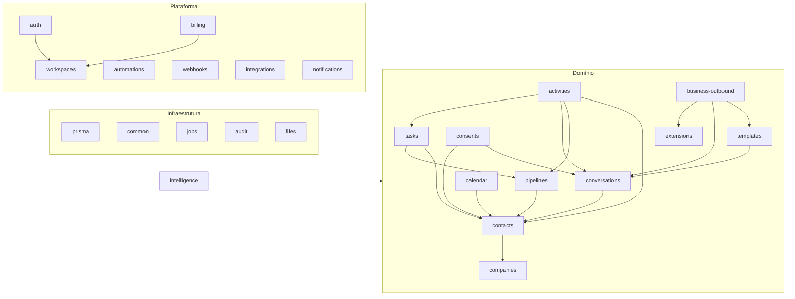

# ARCHITECTURE — Veyra

## 1. Estilo arquitetural

**Monólito modular** (ADR-001): uma API NestJS com módulos de domínio bem delimitados, um SPA React, um Postgres. Sem microsserviços, sem event bus distribuído, sem camadas genéricas (Repository, "core utils") sem necessidade demonstrada em ADR. A modularidade vem de boundaries de import explícitos entre módulos — não de processos separados.

## 2. Visão de contêineres



## 3. Camadas dentro da API

```
Request
  → JwtAuthGuard (global; valida JWT, revalida tokenVersion da membership,
                  seta workspaceId/userId/membershipId no CLS)
  → PermissionsGuard (global, default-deny: endpoint privado sem @RequirePermissions()
                      é negado; @AuthenticatedOnly() é a exceção rara e revisável)
  → ZodPipe (valida body/query contra schema de packages/contracts)
  → Controller (rota + validação; zero lógica de negócio)
  → Service (regra de negócio, auditoria, outbox)
  → PrismaService.db (client extension: filtro automático por workspaceId, fail-closed)
  → PostgreSQL
```

Regras:

- Controllers finos; toda regra vive em services.
- **Sem camada Repository** (ADR-005): se um service cresce demais, divida em dois services.
- **Relógio de agendamento** (ADR-049): um instante que o banco compara com `now()` (claim, lease, varredura) é escrito pelo banco: DEFAULT, trigger ou `now()` em SQL. Nunca pelo `new Date()` do Node nem pelo `@default(now())` e `@updatedAt` do Prisma, que usam o relógio do Node. A sessão do banco fica em UTC.
- Endpoints são privados por padrão (guard global); exceção via `@Public()` explícito. Autorização é **default-deny**: sem `@RequirePermissions(...)`, o endpoint privado é negado; `@AuthenticatedOnly()` cobre o caso raro de rota que só exige autenticação (ADR-016).

## 4. Multi-tenancy (resumo — detalhe em SECURITY.md)

- Toda entidade de domínio tem `workspaceId` e entra no set `WORKSPACE_MODELS`.
- `PrismaService` expõe `db` (extension que injeta `workspaceId` em creates, `AND: [{workspaceId}, where]` em queries, bloqueia `findUnique`/`update`/`delete`/`upsert` e **lança erro** sem workspace no CLS) e `raw` (sem filtro, uso excepcional documentado).
- Violações de unique (P2002), de FK (P2003) e de exclusão (`23P01`, que o Prisma com driver adapter entrega como P2039 genérico, com o código original em `meta.driverAdapterError.cause`) viram **409, nunca 500**, pelo filtro global (`PrismaExceptionFilter`). O `detail` do Postgres, que traz ids e valores, não vai para a resposta nem para o log. A violação de `CHECK` (`23514`) continua 500 **de propósito**: o contrato valida as mesmas faixas, então ela só aconteceria por defeito.
- `raw` restrito a: identidade global (User/RefreshToken), autenticação, provisionamento controlado, jobs cross-workspace, a leitura do relógio do banco (`agoraDoBanco`, texto fixo e sem tabela), rotinas administrativas justificadas. A lista canônica, com os detalhes, é o §2 do `SECURITY.md`.
- FKs compostas garantem integridade cross-workspace no banco (`FOREIGN KEY (workspaceId, xId) REFERENCES X(workspaceId, id)`).
- Defesa em profundidade futura: RLS no Postgres (ADR adiado com gatilho).

## 5. Módulos do Core e grafo de dependências

Módulos previstos em `apps/api/src/`:

`auth`, `workspaces` (workspace, membership, role, team, invite), `contacts`, `companies`, `custom-fields`, `pipelines` (pipeline, stage, deal), `tasks`, `notes`, `activities` (timeline), `conversations` (conversation, message, channel), `consents` (finalidade, consentimento, pedido de parar — ADR-052, F4.1b), `templates` (versões de template do WhatsApp e a revisão — ADR-052, F4.1c-2), `business-outbound` (o envio iniciado pelo negócio: a prévia, a aprovação e o verificador do despacho — ADR-052, F4.1c-3), `calendar`, `notifications`, `files`, `automations`, `webhooks`, `integrations`, `audit`, `billing`, `intelligence`, `jobs`, `prisma`, `common`.

Regras de dependência:



- Módulos de domínio **não se importam lateralmente de forma ad-hoc**; aresta nova estrutural exige ADR.
- `integrations`/`webhooks` são infraestrutura de borda: nunca dependem de módulos de domínio específicos além dos contratos que expõem.
- `intelligence` depende de services de domínio (via tools) — nunca do Prisma.
- Nenhum módulo do Core importa nada de um vertical.
- `templates` depende do canal (a credencial cifrada e a porta do catálogo da Meta) e da transação das mudanças do `content-use` (global, para o `lock_timeout`), e lê as finalidades pelo client protegido, sem importar `consents`; nenhum módulo do Core depende dele na F4.1c-2 (ADR-052).
- `business-outbound` depende do canal (a quota, a escrita da mensagem com a aprovação e a porta do despacho), de `templates` (a releitura) e da porta do E7 em `extensions` (global). O worker de envio, em `channels`, não importa o módulo: ele declara a porta do despacho do negócio (`channels/business-dispatch.port.ts`), e o verificador se registra nela no boot — `templates` já importa `channels`, e o contrário seria ciclo. As finalidades e os consentimentos são lidos pelo client protegido, sem importar `consents` (ADR-052, F4.1c-3). Desde a F4.2, ele exporta o serviço do envio para as rotas dos verticais: as rotas genéricas do Core aceitam só a origem do Core (`conversation:`), e a origem de vertical entra pela rota do vertical, no mesmo processo (ADR-048 adendo 9). O vertical lê a situação das origens dele, o desfecho para as métricas (`desfechosPorOrigem`: a resposta exige `conversations:read` e só conta na conversa identificada e ainda do contato do envio) e as invalida pelo mesmo serviço (`situacoesPorOrigem`, `invalidarOrigensNaTransacao`), sem importar `channels`. Um módulo registra trabalho periódico no agendador do Core por `JobsService.agendarPeriodico`, API neutra (a varredura do texto dos pedidos do Clinics é a primeira). Desde a F4.4, o serviço diz se o envio é simulado pela mesma função que escolhe o transporte falso (`transporteSimulado`, em `common/transporte-simulado.ts` desde a F4.4c, para os procedimentos de um vertical a lerem sem importar o canal): a rota do Core (`GET /api/business-outbound/transport`) responde a quem escreve nas conversas, e o vertical expõe a dele a quem lê a agenda (`GET /api/clinics/outreach/transport`). O Clinics expõe também as opções do envio por tipo (`GET /api/clinics/outreach/options`), com o mesmo filtro de finalidade da prévia (ADR-048 adendo 11). No web, os rótulos dos motivos do envio e do despacho ficam em `lib/motivos-do-envio.ts`, lidos pelo Inbox e pelos verticais.
- `consents` depende do canal (o pedido de parar cancela os despachos) e da conversa (a rota pela conversa usa a visibilidade dela). O caminho inverso — o envio confere o bloqueio, quem tira número do contato revoga o consentimento — usa as funções de `consents/consent-records.ts` na transação de quem chama, sem importar o módulo: a aresta não vira ciclo (ADR-052, F4.1b). Desde a F4.4b, a consulta pelo contato devolve os números exatos dele, e `GET /api/consent-channels` lista os canais de WhatsApp (só id e nome) para a concessão; as telas ficam em `pages/Consentimentos.tsx` (a ficha do contato e a conversa do Inbox), com o registro idempotente de `lib/registro-idempotente.ts` (ADR-048 adendo 12).
- Os templates fictícios da demonstração são dado fora dos módulos do Core, em dois arquivos de `src/demo/`: o conteúdo (`catalogo-da-demonstracao.ts`), único importado pelo catálogo falso do staging (`FakeTemplateCatalog.daDemonstracao`, escolhido por `catalogoDoAmbiente`), e o cadastro (`templates-da-demonstracao.ts`: os vínculos e a finalidade), lido só pelo procedimento `templates:demo` (`cli/templates-demo.core.ts`), que cadastra e revisa pelos serviços de `templates` (ADR-048 adendo 12). A carga dos dados clínicos fictícios é do vertical (`verticals/clinics/cli/demo-carregar.core.ts`, ADR-048 adendo 13): ela usa os serviços do Clinics e o de contatos do Core, e o Core não a conhece. O cadastro do canal é a CLI compilada `cli/channel-whatsapp.ts`, e a varredura de FKs (`check:fk`) também foi para `cli/`, para existir na imagem.

## 6. Estratégia de verticais

Um vertical é um conjunto de módulos NestJS, contratos e telas que estende o Core sem que o Core o conheça (ADR-015). O contrato de extensão está no **ADR-047**; o primeiro vertical, Veyra Clinics para estética, no **ADR-048**.

**Onde mora.** `apps/api/src/verticals/<v>/`, `packages/contracts/src/verticals/<v>/` e `apps/web/src/verticals/<v>/`. O schema fica em arquivo próprio, no **mesmo banco** e na mesma pasta de migrations (schema Prisma em vários arquivos), porque as FKs compostas para entidades do Core exigem o mesmo banco.

**Barreira.** Só a raiz de composição importa `verticals/`: `src/composition.ts` e `app.module.ts` na API, e `src/composition.ts(x)` no web. As extensões entram no Core por `ExtensionsModule.forRoot(COMPOSITION)` (`src/extensions/`). O restante do Core é proibido de importar o vertical por lint e por teste de fronteira, como no ADR-027. Quando o Core precisa de uma resposta do vertical, ele declara uma **porta** com nome neutro, e o vertical a implementa.

**Mecanismos de extensão**, em ordem de preferência:

1. **Custom fields** do Core, para atributo simples sem estrutura e **sem dado sensível**: custom fields herdam as permissões do contato.
2. **Extension table 1:1** sobre entidade do Core, com `@@unique([workspaceId, <x>Id])` e FK composta. Exemplo: `ClinicsPatient(workspaceId, contactId)`. Ler "paciente" é o join da extensão com o contato, via service do vertical.
3. **Entidade própria** do vertical, com as mesmas convenções do Core. Exemplos: `ClinicsUnit`, `ClinicsService`, `ClinicsAppointment`. Quando a entidade tem invariante que o banco precisa garantir (por exemplo, agenda sem sobreposição), ela é dona do próprio dado e **não especializa uma entidade genérica do Core**: o agendamento do Clinics não depende de `CalendarEvent` (ADR-048 §2).

**Os sete pontos de composição (ADR-047; o E7 pelo ADR-052, C10)**, e somente eles:

| #   | Ponto                                          | Resumo                                                                                                                                                                                                                                                                                                                                                                                                                                                                                                                                                                                                                                                                                                                                                                              |
| --- | ---------------------------------------------- | ----------------------------------------------------------------------------------------------------------------------------------------------------------------------------------------------------------------------------------------------------------------------------------------------------------------------------------------------------------------------------------------------------------------------------------------------------------------------------------------------------------------------------------------------------------------------------------------------------------------------------------------------------------------------------------------------------------------------------------------------------------------------------------- |
| E1  | Modelos protegidos                             | Conjunto composto na raiz (Core ∪ vertical) injetado no `PrismaService`; o teste de drift lê todos os arquivos do schema                                                                                                                                                                                                                                                                                                                                                                                                                                                                                                                                                                                                                                                            |
| E2  | Permissões e disponibilidade                   | Catálogo próprio com prefixo do vertical; porta de disponibilidade por workspace; checagem de chaves no boot; `SYSTEM_ROLE_TEMPLATES` intocado                                                                                                                                                                                                                                                                                                                                                                                                                                                                                                                                                                                                                                      |
| E3  | Ativação e papéis do vertical                  | CLI do vertical, idempotente; papéis próprios por `systemKey` com prefixo; desativar revoga acesso e não apaga dados                                                                                                                                                                                                                                                                                                                                                                                                                                                                                                                                                                                                                                                                |
| E4  | Allowlist de auditoria                         | Allowlists compostas; entidade sem allowlist continua como `"[changed]"`                                                                                                                                                                                                                                                                                                                                                                                                                                                                                                                                                                                                                                                                                                            |
| E5  | Navegação e rotas no web                       | A raiz `composition.tsx` entrega ao Core um hook de grupos e as rotas; `useNavGroups()` (`lib/nav.ts`) compõe o mapa para lateral, rastro e busca. Visível só com o status do vertical confirmado como ativo e com a permissão; carregando ou com erro, oculto e sem consultas                                                                                                                                                                                                                                                                                                                                                                                                                                                                                                      |
| E6  | Restrição de conteúdo por contato e consumidor | Porta neutra consultada por IA (todo envio ao provedor, leitura de persistidos, aprovação, despacho) e por webhooks (na entrega); falha fechada; derivada da **presença** do vertical, não do status de ativação; quem muda a restrição de um contato trava a linha dele (ADR-047 adendo 5)                                                                                                                                                                                                                                                                                                                                                                                                                                                                                         |
| E7  | Pré-condição do envio do negócio               | Porta neutra, só de leitura, por prefixo da origem do pedido (`outboundPreconditionProviders`): "vale" com o contato do pedido, os valores dos campos do vertical e as chaves de validade, "não vale", ou indisponível; falha fechada; prazo de 2 s; as chaves são fixadas na aprovação e travadas (`validity:`) na aprovação e no despacho (ADR-052 item 9, F4.1c-3). Desde a F4.2: a porta declara as permissões do vertical que a origem exige, os campos que fornece (os únicos de vertical que um template pode vincular) e as finalidades que são dela (recusadas em qualquer outra origem, inclusive a do Inbox), e devolve o limite do prazo; lê só pelo cliente de quem chama (a transação, na aprovação e no despacho), com o tipo restrito a leituras (ADR-048 adendo 9) |

**O que não é ponto de extensão** (cada um exige ADR próprio): timeline do Core, catálogo de automações e de eventos de webhook, ferramentas de IA sobre dados do vertical, restrição de leitura por contato nas telas do Core, edição de papéis, quotas e billing por vertical.

**Parametrizar o Core** continua valendo quando o efeito é universal. Exemplo: envio de mensagem pelo serviço de conversas, com aprovação humana. (O retorno do Clinics já foi exemplo daqui, como `Task` do Core com título neutro; o ADR-048 adendo 7 o tirou do Core, porque o contato, o responsável e o vencimento revelavam o que o título escondia.) Vale só onde a fronteira de dados do vertical permite: o Clinics, por exemplo, não usa a IA do Core sobre seus contatos (ADR-048 §6).

Direção de dependência: vertical → Core. Nunca o contrário. A skill `create-vertical` operacionaliza este checklist.

## 7. Contratos

- **Internos** (`packages/contracts`): schemas Zod para entrada (`createContactSchema` → `CreateContactInput`) e interfaces TS para saída (`ContactDto`). Backend valida com `ZodPipe`; frontend importa tipos. Fonte única, checada em compile-time nos dois lados.
- **Funções puras compartilhadas** também moram em `packages/contracts` quando a tela e o servidor precisam decidir pela **mesma** regra — por exemplo, a hora local da unidade do Clinics (`resolverHoraLocal`, `horaLocal`; ADR-048 adendo 5). Só funções sem I/O e sem dependência nova; o servidor continua sendo quem decide, a tela só evita o pedido que ele recusaria.
- **API pública**: OpenAPI gerado a partir dos controllers/schemas (ADR-006), versionada (`/api/v1`), autenticada por API key por workspace com escopos = permissões RBAC.
- Ordem de implementação: `packages/contracts` → `apps/api` → `apps/web`.

## 8. Jobs, outbox e efeitos externos

- **pg-boss** no mesmo Postgres (ADR-007). Kill switch `DISABLE_JOBS`.
- Jobs cross-workspace usam o padrão `runForAllWorkspaces`: itera workspaces via `raw` (justificado) e abre `cls.run()` com o `workspaceId` de cada um, try/catch por workspace — falha de um não derruba os outros.
- **Outbox transacional**: efeito externo (webhook out, e-mail, mensagem) nunca é disparado na transação de domínio. A transação grava `OutboxEvent`; um worker pg-boss entrega com retry/backoff exponencial e idempotência (`dedupeKey` + unique tenant-scoped, capturando P2002).
- **Idempotência HTTP**: endpoints de mutação da API pública aceitam `Idempotency-Key` (armazenada por workspace com TTL).

## 9. Observabilidade

- Logging estruturado (pino) com `requestId` correlacionado, `workspaceId`/`userId` do CLS; **nunca** logar payloads sensíveis ou segredos.
- Filtro global de exceções captura só 5xx (4xx é contrato) e enriquece com rota registrada (sem query string).
- Error tracking (Sentry-compatível) inerte sem DSN, com `sendDefaultPii: false`.
- Healthcheck público `GET /api/health`.
- Métricas e tracing: adiados com gatilho (ADR) — primeiro logs bons.

## 10. Frontend

- SPA React + Vite; estado de servidor em TanStack Query, estado de UI em store leve — nunca duplicar estado de servidor.
- Tabelas densas com TanStack Table; formulários com React Hook Form + resolvers Zod dos contratos.
- `lib/api.ts` é o único lugar com fetch; auth por cookies httpOnly (refresh automático em 401 com deduplicação de refresh concorrente).
- **Um cache por sessão (ADR-050).** O `QueryClient` não é global: `SessionQueryProvider` cria um a cada troca de sessão (login, logout, sessão perdida, outra identidade ou outro workspace) e remonta a árvore; quando a aba volta a ficar visível, relê `/auth/me`. `lib/session-scope.ts` guarda o escopo e a época da sessão. `lib/api.ts` é o único lugar com fetch (o lint recusa `fetch` em qualquer outro arquivo do web) e faz o protocolo de sessão:
  - declara o escopo esperado (`X-Veyra-Expected-Scope`), e o guard recusa com 409, antes de executar, a requisição de uma aba desatualizada;
  - aborta e descarta a resposta de outra época ou de outro escopo (`X-Veyra-Scope`);
  - troca a sessão ao ver a marca de sessão emitida (`X-Veyra-New-Session`, posta por `setSessionCookies`). Uma tela nova que faça login, troca de workspace ou aceite de convite **não** chama nada além da API.
- Componentes: primitivos acessíveis Radix/shadcn à la carte em `components/ui/`; componentes de domínio por pasta. Direção visual em `docs/DESIGN_DIRECTION.md`.
- **O E2E tem duas pilhas** (ADR-048 adendo 12). A principal: a API com os jobs desligados e o transporte da Graph, e o banco `veyra_e2e`, semeado pelo setup global. A da demonstração: o transporte e o catálogo falsos, o worker ligado (`NODE_ENV=development`) e o banco `veyra_e2e_demo`, que o próprio comando do servidor recria e prepara pelos procedimentos administrativos (`e2e/demo/preparar.ts`) antes de a API subir — o Playwright sobe os servidores antes do setup global. A semeadura comum fica em `e2e/semeadura.ts`.

## 11. Padrões utilizados (e onde)

| Padrão                       | Onde                           | Por quê                                          |
| ---------------------------- | ------------------------------ | ------------------------------------------------ |
| Client extension fail-closed | `prisma.service.ts`            | Isolamento na camada de dados, não na disciplina |
| Guard global + opt-out       | `JwtAuthGuard` + `@Public()`   | Seguro por default                               |
| Outbox                       | mutações com efeito externo    | Atomicidade domínio+efeito                       |
| Dedupe key                   | notificações, outbox, webhooks | Idempotência barata via unique                   |
| Extension table 1:1          | verticais                      | Estender sem tocar o Core                        |
| CLS (AsyncLocalStorage)      | request e jobs                 | Contexto de tenant sem passar parâmetro          |
| ADR numerado                 | `docs/DECISIONS.md`            | Decisão rastreável no código                     |
