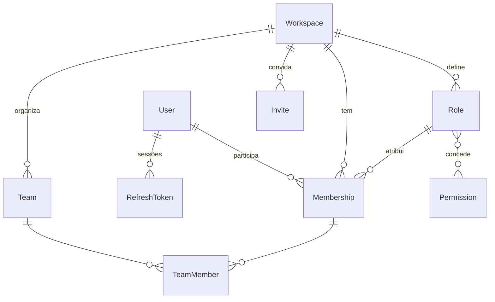
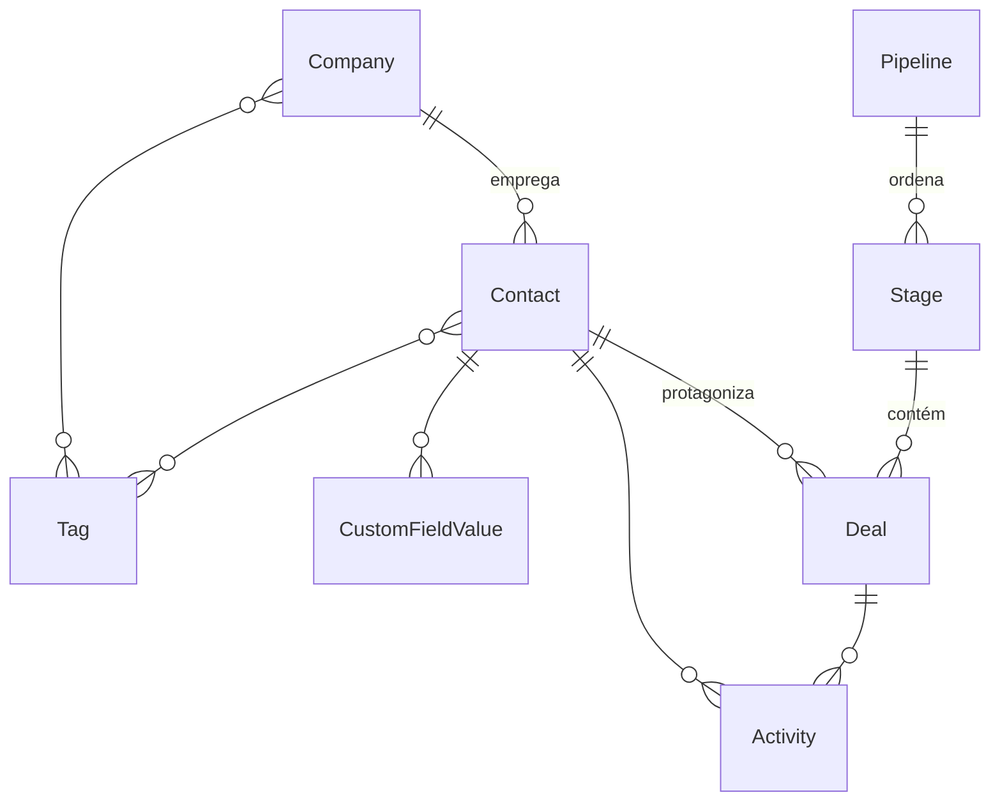

# DOMAIN_MODEL — Veyra Core

Modelo inicial. Nomes de entidades em inglês (código), descrições em pt-BR. Nada aqui é migration ainda — o schema Prisma só nasce na Fase 2.

## 1. Convenções

- IDs: `String @id @default(uuid()) @db.Uuid`.
- `createdAt @default(now())` + `updatedAt @updatedAt` em tudo. **Exceção** (ADR-049): instante que o banco compara com `now()` é escrito pelo banco. Hoje são o `OutboxEvent.nextRetryAt` e o `MessageDispatch.updatedAt`, que usam DEFAULT e trigger.
- Toda entidade de domínio: `workspaceId String @db.Uuid` obrigatório, relação com `Workspace` com `onDelete: Cascade`, índices compostos liderados por `workspaceId` (`@@index([workspaceId, ...])`), uniques tenant-scoped (`@@unique([workspaceId, ...])`).
- Toda entidade referenciável por outra entidade de workspace declara `@@unique([workspaceId, id])` para permitir **FKs compostas** (`FOREIGN KEY (workspaceId, xId) REFERENCES X(workspaceId, id)`) — impedindo relações cross-tenant no próprio banco.
- Dinheiro: `Int` em centavos + `currency` (ISO 4217).
- Sem soft delete genérico; `archivedAt`/`status` onde fizer sentido; exclusão LGPD via cascade a partir de `Workspace` (e de `User` para dados globais).

## 2. Identidade e acesso

| Entidade         | Escopo                | Campos-chave                                                                     | Notas                                                                                                                                                          |
| ---------------- | --------------------- | -------------------------------------------------------------------------------- | -------------------------------------------------------------------------------------------------------------------------------------------------------------- |
| `User`           | **Global**            | email único, name, passwordHash, status                                          | Sem `workspaceId`. Acesso via `raw` justificado                                                                                                                |
| `RefreshToken`   | Global                | userId, tokenHash (SHA-256) único, expiresAt, revokedAt                          | Rotação real: refresh usado é revogado                                                                                                                         |
| `Workspace`      | —                     | name, slug único, status, settings, phoneRegion (BR; ADR-052)                    | Raiz do tenant; cascade para tudo                                                                                                                              |
| `Membership`     | Workspace             | userId, workspaceId, roleId, status (active/suspended/removed), **tokenVersion** | Tenant-scoped. `@@unique([workspaceId, userId])`. `tokenVersion` invalida sessões em revogação/mudança de permissão                                            |
| `Role`           | Workspace             | name, isSystem, description                                                      | **Sempre do workspace**. Padrões (Owner/Admin/Member/Guest) semeados no provisionamento com `isSystem=true` (não editáveis/deletáveis). Não existe Role global |
| `Permission`     | **Global (catálogo)** | key estável (`contacts:read`, `deals:write`, `settings:billing`…)                | Exceção documentada à regra do workspaceId: é catálogo do sistema, não dado do tenant                                                                          |
| `RolePermission` | Workspace             | roleId (FK composta), permissionKey                                              | Junção role↔permissão                                                                                                                                          |
| `Team`           | Workspace             | name                                                                             | `TeamMember` liga a `Membership` com FK composta                                                                                                               |
| `Invite`         | Workspace             | email, roleId (FK composta), tokenHash, expiresAt, acceptedAt                    | Sem registro público: convite é a porta de entrada                                                                                                             |

JWT: `sub` (userId), `membershipId`, `workspaceId` ativo, `tokenVersion`. Troca de workspace reemite token.

## 3. Relacionamento (CRM)

| Entidade                | Campos-chave                                                                                                                                                                                                                     | Notas                                                                                             |
| ----------------------- | -------------------------------------------------------------------------------------------------------------------------------------------------------------------------------------------------------------------------------- | ------------------------------------------------------------------------------------------------- |
| `Contact`               | name, emails[], phones[] (o original), phonesNormalized[] (E.164 válidas) e phoneMatchKeys[] (últimos 8 dígitos do telefone escrito e da forma normalizada; GIN), companyId?, ownerId? (membership, FK composta), source, status | A entidade que verticais estendem (ex.: paciente)                                                 |
| `Company`               | name, domain, size, ownerId?                                                                                                                                                                                                     |                                                                                                   |
| `Tag`                   | name, color, `@@unique([workspaceId, name])`                                                                                                                                                                                     | Junções `ContactTag`/`CompanyTag` com FKs compostas                                               |
| `CustomFieldDefinition` | entityType (contact/company/deal), key, label, type (text/number/date/select/multiselect/boolean), options, required                                                                                                             | Definição por workspace                                                                           |
| `CustomFieldValue`      | definitionId (FK composta), entityId + entityType, value (JSONB validado pelo type)                                                                                                                                              | Único mecanismo "genérico" permitido — e mesmo assim tenant-scoped e tipado pela definição        |
| `Pipeline`              | name, isDefault                                                                                                                                                                                                                  |                                                                                                   |
| `Stage`                 | pipelineId (FK composta), name, order, probability?, type (open/won/lost)                                                                                                                                                        |                                                                                                   |
| `Deal`                  | title, pipelineId, stageId, contactId?, companyId?, ownerId?, amountCents, currency, expectedCloseDate, status, stalledSince?                                                                                                    | FKs compostas para Pipeline/Stage/Contact/Company. Base do lead scoring e da previsão de pipeline |

## 4. Trabalho e timeline

| Entidade   | Campos-chave                                                                                                                                                                                                                                      | Notas                                                                                                                                                                                                                                     |
| ---------- | ------------------------------------------------------------------------------------------------------------------------------------------------------------------------------------------------------------------------------------------------- | ----------------------------------------------------------------------------------------------------------------------------------------------------------------------------------------------------------------------------------------- |
| `Task`     | title, description, dueAt, assigneeId? (membership), status, priority, contactId?, dealId?                                                                                                                                                        | FKs compostas nas referências                                                                                                                                                                                                             |
| `Note`     | body, authorId (membership), contactId?, companyId?, dealId?                                                                                                                                                                                      |                                                                                                                                                                                                                                           |
| `Activity` | type (enum: task_completed, deal_moved, note_added, message_sent, meeting_held, file_attached, ai_action, …), actorType (user/ai/system/api), actorId?, occurredAt, payload mínimo, **contactId?, companyId?, dealId?, conversationId?, taskId?** | **Sem relação polimórfica sem integridade**: referências são colunas FK opcionais tipadas, todas com FK composta (workspaceId, x). Associações mais genéricas só futuramente, e apenas se preservarem FKs e isolamento (registrar em ADR) |

A timeline de um contato/deal é a consulta de `Activity` pelos FKs explícitos — auditável e tenant-safe. Desde a F4.1a (ADR-052, C12), a do contato soma, às atividades com o `contactId` gravado, as atividades sem contato das conversas que hoje são dele: a atribuição de mensagem vem da conversa, e uma conversa rejeitada sai da timeline sem apagar nada.

## 5. Comunicação

Implementado na Entrega 6.1 (ADR-023). A API aceita **somente** canal `internal`; `email`/`whatsapp` estão reservados no enum, sem provider.

| Entidade          | Campos-chave                                                                                                                                                                                                                                                                                                                                                                                                                                                                  | Notas                                                                                                                                                                                                                                                                                                                                                                                                                                                                                                                                                                                                                                                                                                                                                                                                                                                                                                                                                                                                                          |
| ----------------- | ----------------------------------------------------------------------------------------------------------------------------------------------------------------------------------------------------------------------------------------------------------------------------------------------------------------------------------------------------------------------------------------------------------------------------------------------------------------------------- | ------------------------------------------------------------------------------------------------------------------------------------------------------------------------------------------------------------------------------------------------------------------------------------------------------------------------------------------------------------------------------------------------------------------------------------------------------------------------------------------------------------------------------------------------------------------------------------------------------------------------------------------------------------------------------------------------------------------------------------------------------------------------------------------------------------------------------------------------------------------------------------------------------------------------------------------------------------------------------------------------------------------------------ |
| `Channel`         | type (internal/email/whatsapp), name, **systemMark** (TRUE/NULL)                                                                                                                                                                                                                                                                                                                                                                                                              | Exatamente **um** canal interno por workspace: `@@unique([workspaceId, systemMark])` + CHECK (`systemMark` só TRUE, e só em `internal`)                                                                                                                                                                                                                                                                                                                                                                                                                                                                                                                                                                                                                                                                                                                                                                                                                                                                                        |
| `Conversation`    | channelId (FK composta), contactId? (FK composta), subject?, status (open/pending/closed), assigneeMembershipId? (FK composta), **lastMessageAt NOT NULL**, externalAddress?, senderStatus (identified/unidentified — ADR-052), senderIdentifiedAt?, openMark e unidentifiedOpenMark (por gatilho)                                                                                                                                                                            | `lastMessageAt` já nasce preenchido — o keyset do inbox `(lastMessageAt, id)` não tem caso especial de null. Mensagem em conversa fechada a reabre, exceto se já houver outra aberta da mesma chave (409). Uma conversa aberta por (canal, contato, número) e uma RAI aberta por (canal, número), garantidas por único com as marcas. A RAI ("remetente a identificar") nunca tem contato (CHECK), não recebe resposta, e só o serviço de identificação muda `contactId`                                                                                                                                                                                                                                                                                                                                                                                                                                                                                                                                                       |
| `Message`         | conversationId + channelId em **FK TRIPLA** `(workspaceId, channelId, conversationId) → Conversation(workspaceId, channelId, id)` — o canal da mensagem é obrigatoriamente o da conversa; `channelId` é derivado da conversa no servidor, direction (inbound/outbound), authorType, authorMembershipId?/authorContactId? (FKs compostas; desde a F4.1a, a mensagem nova não grava `authorContactId`: a atribuição ao contato vem da conversa), body, deliveredAt, externalId? | **Append-only** (`APPEND_ONLY_MODELS`). `@@unique([workspaceId, channelId, externalId])` para dedup de ingestão; `externalId` é id de OUTRO sistema, exceção documentada no `check:fk`                                                                                                                                                                                                                                                                                                                                                                                                                                                                                                                                                                                                                                                                                                                                                                                                                                         |
| `MessageDispatch` | messageId (PK e FK composta para a mensagem), state, reservationId, leaseExpiresAt + claimToken (posse com fencing), dispatchedAt (marcador de despacho), template pedido, externalId, errorCode, attempts, **approvalContactIds** (uuid[]), **fromAiProposal**                                                                                                                                                                                                               | O envio pelo canal externo (ADR-039). `approvalContactIds` são os contatos conferidos por quem APROVOU o envio: na aprovação do rascunho da IA (ADR-047 adendo 7 §9, G3.2), o envio da IA trava e reconfere todos eles, somados ao contato atual da conversa, sob a guarda de uso externo; na mensagem escrita por pessoa (ADR-052, revisão da F4.1a), é o contato da conversa quando ela escreveu. Nos dois, o worker não envia se a conversa tiver sido religada desde então (`conversation_relinked`). Como a RAI não recebe resposta, toda mensagem na fila foi escrita para um contato. Sem FK, validados na escrita e conferidos pelo `check:fk`. `fromAiProposal` é a ORIGEM DE IA: o despacho nasceu da aprovação de uma proposta da IA, editada ou não, e sai sob a restrição e a guarda como o da IA, mesmo com `authorType = 'user'` (decisão de 2026-10-21). Em dúvida, o despacho fica `unknown_after_dispatch` e nunca é reenviado; quando a guarda provou que ele não saiu, o código é `not_sent_guard_aborted` |

O autor é **derivado da direção**, nunca informado pelo cliente: `outbound` → membership da sessão; `inbound` → contato da conversa (conversa sem contato recusa entrada). O envio manual é `@Idempotent()`: duplo clique não duplica mensagem nem `Activity`.

Timeline: `Activity` ganhou `conversationId` (FK composta) e os tipos `message_sent`/`message_received`, com **payload vazio** — o corpo da mensagem nunca entra na timeline.

## 6. Organização

Agenda e notificações implementadas na Entrega 6.2; arquivos entram na 6.3.

| Entidade        | Campos-chave                                                                                                                                                                 | Notas                                                                                                                                                                                                                            |
| --------------- | ---------------------------------------------------------------------------------------------------------------------------------------------------------------------------- | -------------------------------------------------------------------------------------------------------------------------------------------------------------------------------------------------------------------------------- |
| `CalendarEvent` | title, description?, startAt, endAt, location?, status (scheduled/done/canceled), organizerMembershipId, contactId?, dealId? — **todas as relações em FK composta**          | **CHECK `endAt > startAt` no banco**, além do Zod. Consultado sempre por JANELA (eventos que intersectam `[from, to)`), nunca "tudo". Verticais especializam sem tocar nele                                                      |
| `Notification`  | recipientMembershipId (FK composta), type, payload (allowlist Zod `.strict()` por tipo), **dedupeKey**, readAt                                                               | `@@unique([workspaceId, dedupeKey])` — emissão idempotente. Caixa **pessoal**: o destinatário é sempre a membership da sessão, imposto no service                                                                                |
| `FileObject`    | key (storage prefixado por workspace), fileName, mimeType detectado por magic bytes, sizeBytes, uploadedById, scanStatus (pending/clean/quarantined), conversationRestricted | Entrega 6.3. Política completa em SECURITY.md §7. `conversationRestricted` (ADR-052) mantém a regra dos anexos de conversa sem vínculo: nasce na mídia recebida, e é marcada na quarentena que a exclusão de um contato preserva |

Emissão de notificação acontece **dentro da transação do fato que a origina** — notificação de evento que não existe é impossível. Hoje há dois produtores: evento agendado para outra pessoa e conversa atribuída a outra pessoa. Em ambos, quem age **não** se autonotifica (regra formalizada no ADR-026), e o `dedupeKey` é o par (fato, destinatário).

## 7. Plataforma

| Entidade                                 | Campos-chave                                                                                                                                                                                                                                                          | Notas                                                                                                                                                                                                                                                                                                                                                                                                                                                                                                                                                                                                                                                                                                                                                                                 |
| ---------------------------------------- | --------------------------------------------------------------------------------------------------------------------------------------------------------------------------------------------------------------------------------------------------------------------- | ------------------------------------------------------------------------------------------------------------------------------------------------------------------------------------------------------------------------------------------------------------------------------------------------------------------------------------------------------------------------------------------------------------------------------------------------------------------------------------------------------------------------------------------------------------------------------------------------------------------------------------------------------------------------------------------------------------------------------------------------------------------------------------- |
| `Automation`                             | name, trigger (evento de domínio), conditions, actions, enabled                                                                                                                                                                                                       | v1: triggers/ações de catálogo fechado                                                                                                                                                                                                                                                                                                                                                                                                                                                                                                                                                                                                                                                                                                                                                |
| `Webhook`                                | url, events[], secret cifrado, status                                                                                                                                                                                                                                 | Entrega via outbox, assinatura HMAC                                                                                                                                                                                                                                                                                                                                                                                                                                                                                                                                                                                                                                                                                                                                                   |
| `Integration` / `IntegrationCredential`  | provider, status / credenciais cifradas AES-256-GCM                                                                                                                                                                                                                   | Sem SDK pesado por padrão                                                                                                                                                                                                                                                                                                                                                                                                                                                                                                                                                                                                                                                                                                                                                             |
| `ApiKey`                                 | name, keyHash, scopes (permission keys), lastUsedAt, revokedAt                                                                                                                                                                                                        | API pública                                                                                                                                                                                                                                                                                                                                                                                                                                                                                                                                                                                                                                                                                                                                                                           |
| `AuditLog`                               | actorType (user/ai/system/api), actorId?, action, entityType, entityId, before/after (allowlist + redaction), requestId, createdAt                                                                                                                                    | Append-only; retenção em SECURITY.md                                                                                                                                                                                                                                                                                                                                                                                                                                                                                                                                                                                                                                                                                                                                                  |
| `OutboxEvent`                            | eventType, payload, dedupeKey, status (pending/processing/delivered/dead), attempts, nextRetryAt, subjectContactIds (UUID[], sem FK)                                                                                                                                  | Gravado na transação de domínio. `subjectContactIds` é a fotografia dos contatos do evento na emissão (ADR-047 adendo 2): sem FK de propósito, com isolamento por workspace conferido no `enqueue` e zerada no estado terminal, que é definitivo (trigger no banco, adendo 3); evento derivado (automação) herda a fotografia do evento de origem                                                                                                                                                                                                                                                                                                                                                                                                                                     |
| `ContentUse`                             | kind, status (authorized/concluded/aborted/in_doubt), detectedBy (commit/change/workspace_change/reconciliation/missing_record/overran_deadline), contactIds e reservationIds (UUID[], sem FK), entityKeys, origin, runMetadata, instanceId, authorizedAt, deadlineAt | Registro durável de um uso externo de conteúdo de contato (ADR-047 adendos 6 e 7), comitado ANTES da chamada. Só ids, nunca conteúdo. `contactIds` é histórico de incidente (sem FK, isolamento conferido pela checagem de dados do `check:fk`); `reservationIds` aponta reservas efêmeras; `instanceId` identifica o processo. Os três tipos (`ai_generation`, `ai_message_dispatch`, `webhook_delivery`) têm especificação registrada pelo módulo dono. No webhook, um uso por destino e por tentativa: origem `{deliveryId, webhookId, outboxEventId}` e metadado `{attempt}`; em dúvida, a `WebhookDelivery` daquela tentativa nasce como falha incerta (`in_doubt`). `concluded`/`aborted` expurgados em 30 dias; `in_doubt` fica pela retenção da auditoria e depois sai também |
| `IdempotencyKey`                         | key, requestHash, responseSnapshot, expiresAt                                                                                                                                                                                                                         | `@@unique([workspaceId, key])`                                                                                                                                                                                                                                                                                                                                                                                                                                                                                                                                                                                                                                                                                                                                                        |
| `Plan` / `PlanLimit` (globais, catálogo) | key, name, priceCents (**centavos de USD**), **isDefault** (marca TRUE/NULL, unique) / metric, **kind** (counter\|gauge), value (BigInt)                                                                                                                              | Catálogo global como `Permission`. Limites em LINHAS consultáveis, nunca JSON. `BigInt` porque bytes de storage estouram int32 em 2 GiB. `isDefault` é **load-bearing** desde o ADR-041: define o teto herdado por quem não tem assinatura ativa, e para métrica de custo de terceiro a AUSÊNCIA da linha de limite significa lacuna de configuração, não "ilimitado"                                                                                                                                                                                                                                                                                                                                                                                                                 |
| `Subscription`                           | planKey, status, currentPeriodStart/End                                                                                                                                                                                                                               | Um por workspace; atribuída por **CLI administrativa** (ADR-034). O backfill cobriu os existentes, mas o sistema NÃO pressupõe que exista: sem assinatura ativa, métrica de custo de terceiro herda o teto do plano padrão (ADR-041)                                                                                                                                                                                                                                                                                                                                                                                                                                                                                                                                                  |
| `UsageCounter`                           | metric, period, value (BigInt)                                                                                                                                                                                                                                        | `@@unique([workspaceId, metric, period])` — alvo do incremento atômico. `period` é `YYYY-MM` para counters e vazio para gauges                                                                                                                                                                                                                                                                                                                                                                                                                                                                                                                                                                                                                                                        |
| `UsageReservation`                       | metric, period, amount, expiresAt                                                                                                                                                                                                                                     | Reserva de custo de IA (ADR-033): o valor JÁ está no contador; esta linha existe para devolvê-lo se o processo morrer                                                                                                                                                                                                                                                                                                                                                                                                                                                                                                                                                                                                                                                                 |

## 8. Inteligência

| Entidade        | Campos-chave                                                                                                                                                                                                                              | Notas                                                                                                                                                                                                                                                                      |
| --------------- | ----------------------------------------------------------------------------------------------------------------------------------------------------------------------------------------------------------------------------------------- | -------------------------------------------------------------------------------------------------------------------------------------------------------------------------------------------------------------------------------------------------------------------------- |
| `AiRun`         | capability, promptVersion, model, contextSummary (mínimo, sem payload bruto), inputTokens, outputTokens, costCents, latencyMs, status (ok/error/refused/unknown_after_dispatch), actionTaken (none/proposed/executed), triggeredByType/Id | Todo run persiste isto — base de custo por workspace e de evals. Sob a guarda de uso externo (ADR-047 adendo 7 §9), o id é gerado antes da chamada e o run é gravado na transação da guarda; `unknown_after_dispatch` = o uso ficou em dúvida e o resultado foi descartado |
| `AiProposal`    | runId, type (send_message/update_deal/create_task/…), payload, status (pending/approved/rejected/expired), reviewedById, reviewedAt                                                                                                       | MVP: toda ação externa passa por aqui                                                                                                                                                                                                                                      |
| `PromptVersion` | (catálogo global) capability, version, hash, changelog                                                                                                                                                                                    | Prompt versionado fora do código de negócio                                                                                                                                                                                                                                |
| `AiConsent`     | flags de consentimento por workspace (ex.: usar conteúdo de conversas)                                                                                                                                                                    | Padrão opt-in: capacidade ausente ≠ check no execute                                                                                                                                                                                                                       |

## 9. O que NÃO é modelado (deliberadamente)

- Qualquer conceito vertical: paciente, prontuário, imóvel, visitante, matrícula, apólice.
  Os modelos de um vertical ficam no arquivo de schema dele (`prisma/schema/<vertical>.prisma`) e são documentados no ADR do vertical (Clinics: ADR-048 e adendo 3 do ADR-047). O arquivo do Core só cita esses modelos como lado reverso de relação (`ClinicsContactRelease[]` em `Contact`, por exemplo), exigência mecânica do Prisma guardada por teste.
- Role global ou "super-admin de produto" no modelo de tenant (operação administrativa é rotina `raw` justificada, fora do RBAC de workspace).
- Relações polimórficas sem FK (`entityType + entityId` soltos) — exceto `CustomFieldValue` e `AuditLog`, que são tenant-scoped, não navegáveis e existem exatamente para isso.
- Event sourcing, CQRS, filas distribuídas.
- Registro público de usuário.
